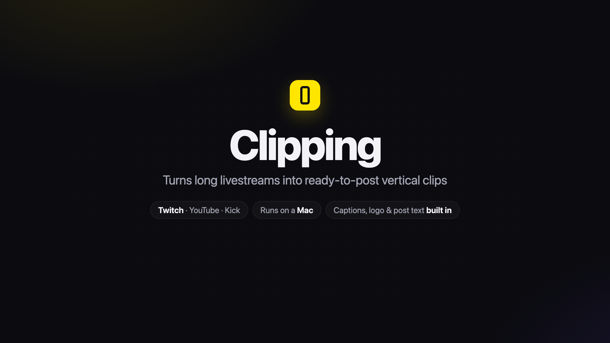

# Clipping

Turns a two-hour livestream into ready-to-post vertical clips, in a few minutes, on a Mac.

Paste a Twitch, YouTube or Kick link. Clipping finds the moments where chat and volume spike, transcribes them on the
Mac, and has an AI rank the ones worth posting. Pick one and it makes a 1080×1920 clip with word-by-word captions, a
hook line, a line of context for viewers who missed the stream, and your logo. It also writes the YouTube and
Instagram text.

[](docs/clipping-demo.mp4)

**[▶ Watch the 3-minute demo](docs/clipping-demo.mp4)**. The video was recorded, narrated and edited by the tool's own
script (`demo/`), with no editing by hand.

Built by **Ashutosh Anand Sharma** ([@Ashutoshvashisht007](https://github.com/Ashutoshvashisht007)). Clips are
posted on Instagram as [@hype_spice](https://www.instagram.com/hype_spice).

## What it does

- **Finds the moments.** Reads the chat replay (Twitch) and the volume across the whole stream, and picks the spikes.
  Videos of 3 minutes or less become a single moment. Kai Cenat's two-hour first GTA 6 stream gives about ten moments
  in two to three minutes.
- **Explains them.** An AI reads the 8 minutes before a moment, writes a short context line for the first seconds of
  the clip, and moves the start back to where the setup begins.
- **Makes the clip.** Downloads only that part, cuts the silences, and writes word-by-word captions on the Mac. Then it
  renders the vertical clip with the camera on top, the hook, the context line and the logo.
- **Fixes what's misheard.** A caption editor changes a word in one clip or in every future clip of that streamer
  ("cold warmer" → "Cole Palmer").
- **Follows streams live.** It checks a live stream every 20 minutes and collects moments while the streamer is still
  live.
- **Keeps you honest.** Each streamer's permission is recorded, and without it only practice clips are made.
  Moments that may spoil GTA 6's story are flagged.

## How it's built

- **Python 3.13** engine (`bin/clipkit.py`), with **ffmpeg** (libass captions), **yt-dlp** and **streamlink** for
  the streams.
- **Captions on the Mac:** NVIDIA's Parakeet TDT 0.6B v3 on Apple's MLX. Long audio is read in 2-minute pieces
  (11 GB → 3 GB of memory), and transcriptions take turns across jobs so the Mac stays responsive.
- **Twitch audio** is fetched as parallel 10-second pieces: 20 minutes in 30 s instead of 163 s. Chat comes from
  Twitch's public replay API.
- **AI ranking and text:** a small model on OpenCode Go, under $0.003 per stream. When the AI is down, refuses the
  key or runs out of credit, it pauses itself (5 minutes to 12 hours, by cause) and the tool carries on without it.
- **The page:** a small local web app (standard-library Python server plus plain JavaScript) that runs every step as
  its own job, with progress, stop and retry.
- **The demo video:** Playwright drives the real page and records every frame, Kokoro-82M speaks the narration, and
  ffmpeg cuts it together.

## Install (macOS, Apple Silicon)

```
brew install ffmpeg-full deno
python3.13 -m venv .venv && .venv/bin/pip install -r requirements.txt
.venv/bin/hf download mlx-community/parakeet-tdt-0.6b-v3 --local-dir models/parakeet-tdt-0.6b-v3   # 2.5 GB
bin/clip check
```

Then follow [One-time setup](#one-time-setup) below. The AI key (OpenCode Go) is optional: without it, moments are
ranked by chat and volume only.

## Licence

The code is public so it can be read and evaluated. It is **not open source**: all rights reserved (see `LICENSE`).
Credits: captions by [Parakeet TDT 0.6B v3](https://huggingface.co/mlx-community/parakeet-tdt-0.6b-v3) (NVIDIA,
CC BY 4.0); demo voice [Kokoro-82M](https://huggingface.co/hexgrad/Kokoro-82M) (Apache-2.0); demo gameplay from
[Kai Cenat](https://www.twitch.tv/kaicenat)'s stream.
Demo music: Tokyo Music Walker - Way Home is under a YouTube Free license
([artist](https://www.youtube.com/channel/UC3lLfvhpPGtwd5qD25cMDcA)). Music powered by BreakingCopyright:
https://youtu.be/Q7HjxOAU5Kc. Find more music here: https://breakingcopyright.com

---

# Using it

## The page (easiest)

Double-click **Clipping.command** in this folder (or run `bin/clipui`). A Terminal window opens and the page opens in
your browser at http://localhost:8765. Keep that Terminal window open while you work; close it to stop.

- **Find moments:** paste a stream link and press Find moments. Click a moment to watch it right there, set the start
  and end (±1 s buttons, or "Start/End = video's time now"), add a hook and press **Make clip**.
  A single Twitch clip link works too: it goes straight to making the clip. A video of 3 minutes or less (an
  already-edited highlight) becomes one moment covering the whole video, plus the AI's pick of its best part.
  The ✕ on a stream in the list deletes it: its moments file goes to the Bin and the analysis download is deleted;
  clips made from it stay.
  **Context:** when you open a moment, the tool reads the 8 minutes before it (with the AI on). It fills in a
  **context line** that's shown for the first few seconds of the clip, so strangers get what's going on, and a
  **background** sentence that opens the YouTube and Instagram text. It also moves the start back to where the
  setup begins (Undo puts it back). You can edit all of it; −30 s / +30 s buttons help with the times. The
  caption editor can change the hook and context line of a finished clip too.
- **Clips:** every clip with its YouTube title, YouTube description and Instagram caption (edit, then Copy), the
  before-posting checklist, and, once posted, the links and views that go into `log.csv`.
  - **Edit captions** fixes misheard words in the video's captions and re-makes the clip (about 30 s).
    "Replace everywhere" + "Always" adds the fix to `fixes.yaml`, so that streamer's new clips come out right.
  - **Write with AI** (re)writes the three post texts. New clips get them automatically (`clips.ai_text` in config.yaml).
- **The AI pauses itself** when it's unreachable, refuses the key or the usage limit is reached: until it's back,
  moments are ranked by chat and volume, and clips get the plain title and hashtags. It tries again by itself (after
  5 minutes, or 1 hour for the limit, then longer); "Try AI now" in Streamers & setup tries straight away.
- **Live mode:** Streamers & setup → **Follow live** on a streamer (Terminal: `clip live <streamer>`). If they're
  offline it waits; once they're live it checks the newest part every 20 minutes and adds the moments to the top of
  that stream's list, with a Mac notification. Twitch is read straight from the stream's replay, chat included.
  YouTube and Kick are recorded to `inbox/live/` (about 350 MB an hour, deleted after 7 days) and checked from the
  recording, without chat. Make clips from live moments as usual, while the stream is still going.
- **Your logo:** every new clip gets your logo (`brand/`), cut out of its background automatically.
  Streamers & setup → "Your logo on every clip" sets where it goes and how big, changes the logo, and updates
  existing clips to match (Terminal: `clip brand logo <picture>`, `clip brand apply`). Clips the logo was added to
  afterwards keep a logo-free copy in `inbox/_unbranded/`, so moving or removing the logo never doubles it.
- **Streamers & setup:** record each streamer's permission, set their camera box by dragging on a frame, add or
  delete streamers, record a live stream, and check that the tools, caption model and AI key are found.
  Deleting a streamer keeps a copy of the old list as `streamers.yaml.bak`; their streams and clips stay.
- **One transcription at a time:** Find, Make and Context can run together, but they take turns on the caption
  model, so the Mac stays responsive. Long audio is read in 2-minute pieces.

The page only listens on this Mac. It runs the same commands as below, so everything still works from Terminal too.

## Every day (Terminal)

1. **Find moments.** `findmoments <Twitch VOD / YouTube / Kick link>`
   This writes `moments/<streamer>/<date>-….md`. Open it, watch each moment with its link, and keep the good ones.
   *Shortcut:* on the streamer's Twitch page, go to **Videos → Clips → Top 24H** and use a clip link directly in step 2.
2. **Make the clip.** Copy the `makeclip …` line from the moments file into Terminal,
   or run `makeclip <clip link> <streamer>`.
   You get `out/<date>/<streamer>-<time>.mp4`, plus a `.txt` file with the title, credit, hashtags and a checklist.
3. **Finish.** Watch it on your phone and tick the checklist. Fix anything in Kdenlive if needed.
4. **Post** on YouTube Shorts and Instagram Reels, then paste both links into `log.csv`.
5. **Every Sunday**, fill in views, % watched, follows and shares in `log.csv`.
   Then do more of whatever brings **follows**.

## One-time setup

- **Use the commands from any folder.** Run this once, then open a new Terminal window:
  `echo 'export PATH="$HOME/Developer/Clipping/bin:$PATH"' >> ~/.zshrc`
- **Permission.** For each streamer in `streamers.yaml`, set `permission.source` and `permission.proof`.
  `makeclip` refuses streamers without them. Add `--practice` for clips you won't post.
- **Camera position.** Run `clip camera <streamer> <stream link> <time when the camera is visible>`, drag a box
  around the camera, then press Enter. A preview opens. For a streamer with no camera, use `clip camera <streamer> --none`.
- **Add your OpenCode Go key.** Run `security add-generic-password -a "$USER" -s opencode-go -w`, then paste the key
  when asked (it won't show on screen). It's stored in your Mac's Keychain, not in any file.
  A line `opencode_go_key=…` in this folder's `.env` file works too, but that file is plain text: never share or zip
  the folder with it inside.
  To turn the AI step off, set `rank.provider: none` in `config.yaml`.
- **Check everything:** `clip check`

## Commands

| Command | What it does |
|---|---|
| `findmoments <link>` | Finds chat and volume spikes, drops loud moments with nobody talking, transcribes the rest, and ranks them (AI, if a key is set). |
| `findmoments <link> --from 4:00:00` | Analyses only part of a stream, e.g. the last few hours. `--to` works too. |
| `findmoments <link> --full-audio` | Downloads the whole audio, so volume spikes count even where chat was quiet. Slower. |
| `makeclip <link> <start> <end> <streamer>` | Makes the vertical clip. Options: `--hook "text"`, `--title "text"`, `--layout full`, `--keep-silence`, `--practice`, `--again`. |
| `clip camera <streamer> <link> <time>` | Sets where the camera sits. You can also give `--box X,Y,W,H` in pixels instead of dragging. |
| `clip record <streamer>` | Records a live stream to `inbox/live/`. Then run `findmoments <file> --streamer <name>` (volume only, no chat). |
| `clip check` | Checks tools, the caption model, the AI key, permissions and camera boxes. |

Times can be written `1:23:45`, `83:45`, `5025` or `1h23m45s`.

## Where things are

| Path | What |
|---|---|
| `streamers.yaml` | Who you clip: channel, credit handle, permission proof |
| `config.yaml` | AI model, caption style, hashtags, silence cutting |
| `moments/` | One moments file per analysed stream |
| `out/<date>/` | Finished clips + caption text (`out/practice/` for practice clips) |
| `log.csv` | One row per clip, for your weekly review |
| `state.json` | What's already been analysed or clipped, so nothing is done twice |
| `inbox/` | Downloaded pieces. Deleted automatically after 7 days |
| `layouts/` | Camera boxes and previews |

## Rules built in

- No permission proof means no clip, except practice clips.
- Moments the AI thinks spoil GTA 6's story are flagged. Don't post them.
- If a clip overlaps one you've already made from the same stream, makeclip stops. Add `--again` to make it anyway.

## Demo video

`demo/make_demo all` records the page and builds a narrated 3-minute demo video (`demo/out/clipping-demo.mp4`), with no
editing by hand. See `demo/README.md`. After a rebuild, copy it and its poster to `docs/` (`clipping-demo.mp4`,
`demo-poster.png`) so the README shows the new one.
